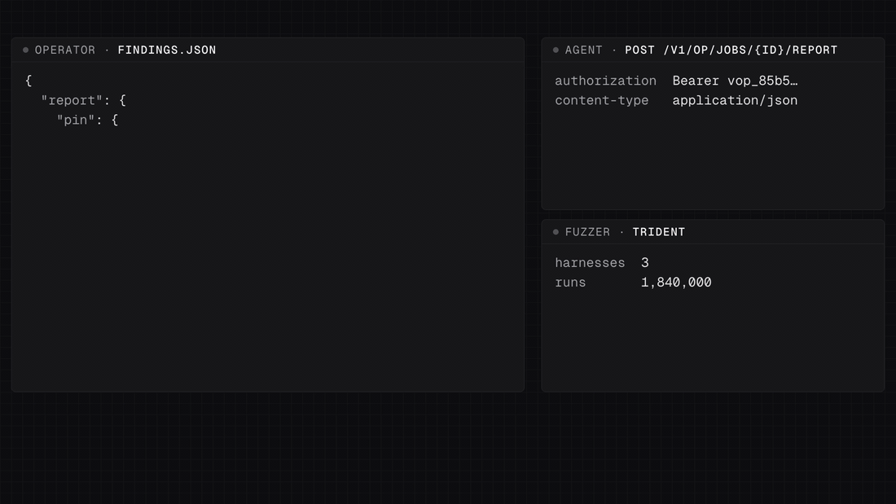
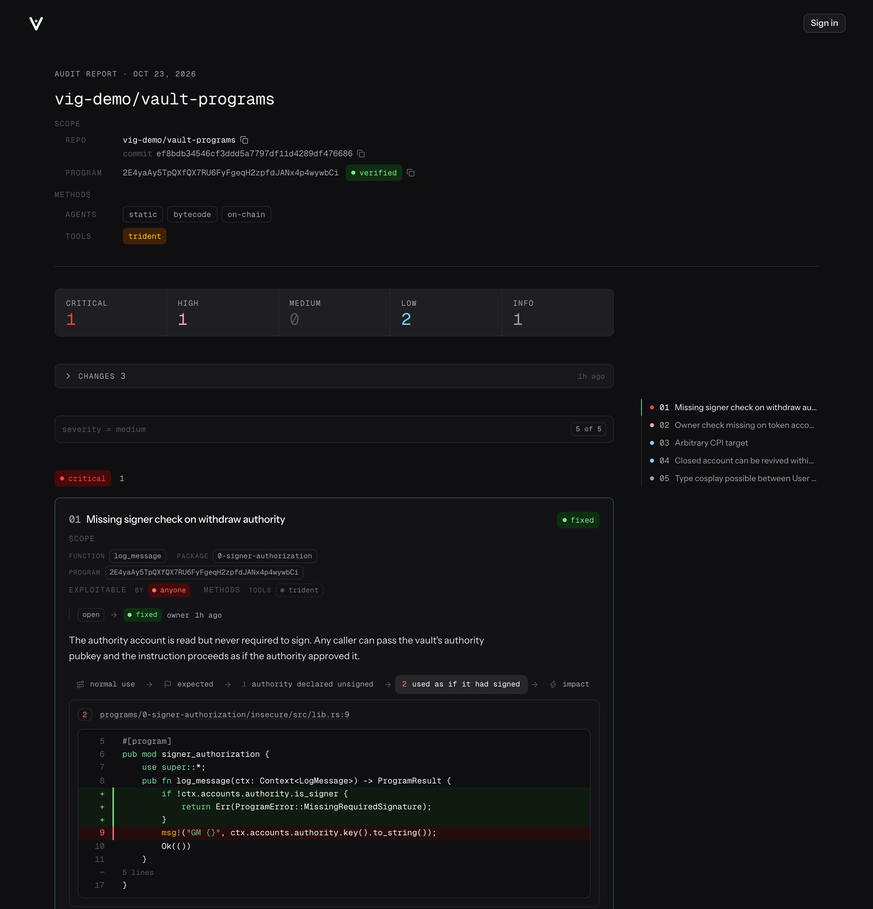
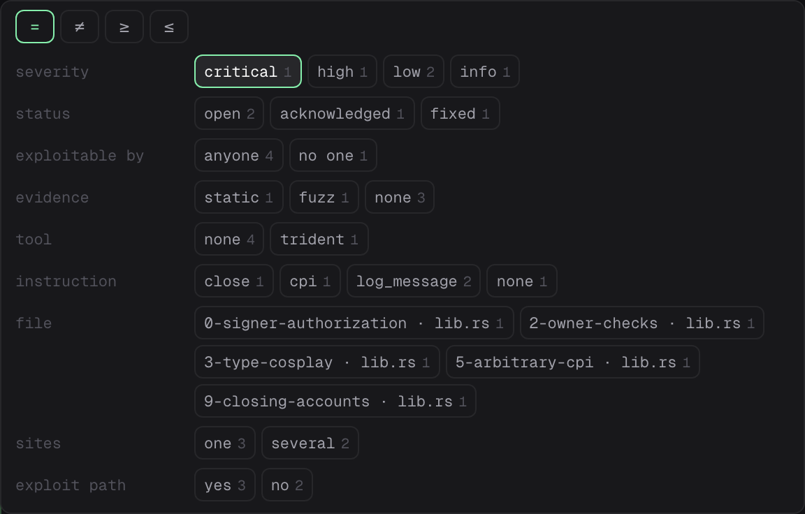
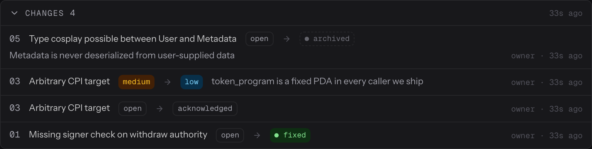
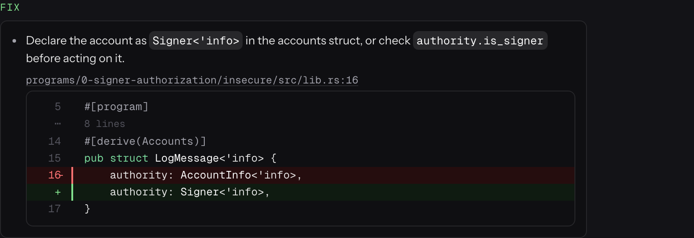
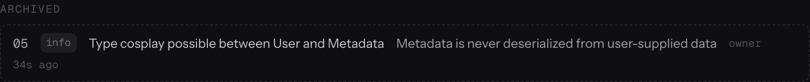
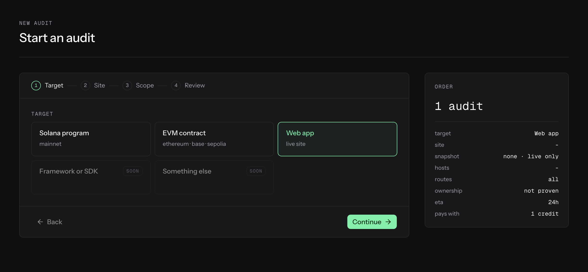
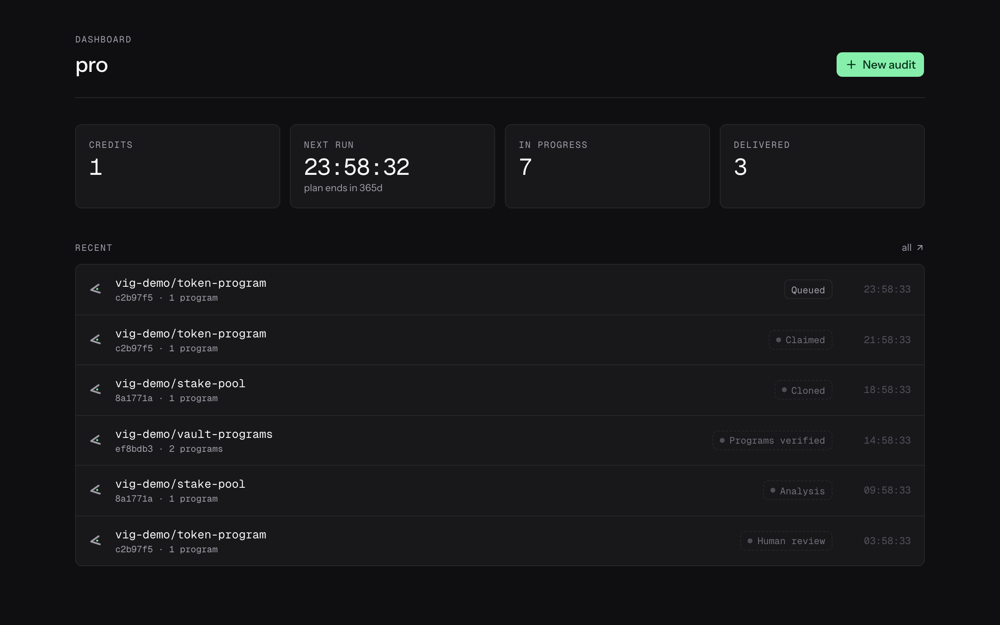

# Reporting Dashboard and Determinism Layer for Security Audit Reports

<p align="center">
  
</p>

<p align="center">
<a href="https://github.com/forefy/vig/releases/"></a>


<a href="https://github.com/forefy/vig/issues/new"></a>

<a href="https://twitter.com/forefy"></a>
</p>

<p align="center">
<a href="https://github.com/forefy/vig/discussions" title="vig Discussions">Discussions</a>
| <a href="https://github.com/forefy/vig/issues/new" title="vig Feature request">Feature request</a>
| <a href="SPEC.md" title="vig Spec">Spec</a>
| <a href="https://twitter.com/messages/compose?recipient_id=1469398978185809922" title="Forefy Twitter DM">Twitter DM</a>
</p>

##  What is vig

vig is a reporting dashboard and determinism layer for security audit reports.

Findings arrive from anywhere, and from the agentic context you send them to vig for a customer-ready report standards. vig then enforces your agent to submit correct data, correct lengths, chained inputs, and report finding formats aggregated from a decade of writing and reviewing reports.

<p align="center">A delivered report</p>
<p align="center">

</p>

<table>
  <tr>
    <td width="50%"><br><sub><b>Fold the findings by anything they share.</b> One query line, facets drawn from the schema, counts that narrow as you type.</sub></td>
    <td width="50%"><br><sub><b>Every correction, kept.</b> Archives, re-ratings and status moves with their reasons, on the finding and in one log; the counts follow.</sub></td>
  </tr>
  <tr>
    <td><br><sub><b>Fixes are patches.</b> Code that names its place is a diff against those lines at the pinned commit, linked to them.</sub></td>
    <td><br><sub><b>Archived, not deleted.</b> A finding judged not relevant leaves the counts and stays on the report with the reason; it is a lesson for the next audit.</sub></td>
  </tr>
  <tr>
    <td><br><sub><b>One wizard, many targets.</b> Programs, contracts and live sites are adapters; the steps come from the adapter, the order reads the same.</sub></td>
    <td><br><sub><b>The dashboard.</b> Credits, the next run, every audit with its state. Facts as badges, never a sentence of help text.</sub></td>
  </tr>
</table>

Everything above is the seeded demo (`make seed`): invented targets with invented findings. The film is the web audit at `/r/ledgerly-invoice-idor`; the report shot and the grid are the Solana audit at `/r/vault-signer-check`.

- [Determinism](#determinism)
- [The dashboard](#the-dashboard)
- [Where findings come from](#where-findings-come-from)
- [How to run it locally](#how-to-run-it-locally)
- [What is in the box](#what-is-in-the-box)
- [For agents and operators](#for-agents-and-operators)
- [What is missing](#what-is-missing)

## Determinism

<p align="center">
  <picture>
    <source media="(prefers-color-scheme: dark)" srcset="docs/hero/hero-dark.svg">
    <source media="(prefers-color-scheme: light)" srcset="docs/hero/hero-light.svg">
    
  </picture>
</p>

Two reports of the same code by two different authors should disagree only where the authors disagree, never in shape, in what they point at, or in what counts. vig enforces that at the door.

- **One shape.** A findings document is the single exchange format: the operator CLI posts it, an agent emits it, the page renders it, the JSON export is it. Validation refuses anything outside the shape: prose over 600 characters a paragraph, a fix that is not bullets, a fence that names a place that does not exist, an attachment the audit does not hold.
- **Pinned.** Every report names the repository, the full commit and, for a chain target, the deployed program and its bytecode hash, with the match said plainly: `verified`, `self-built`, `mismatch` or `unverified`. The code at every location is captured from that commit when the report is submitted, so the report never depends on the repository staying where it was.
- **Evidence bound.** A finding says how it was established: static reading, a fuzz crash, an on-chain transaction, a bytecode offset, a live request. Captures, recordings and files are stored by content and referenced by id; a document cannot claim a type, a name or a size the bytes do not have.
- **Patches, not prose.** A fix that names lines renders as a diff against those lines at the pinned commit, linked to them, with the original lines shown as removed.
- **Nothing is lost.** Severity re-ratings and archivals take a reason and stay on the finding forever, through every revision. Archived findings leave the counts, never the report. The summary is derived from the current ratings, never edited.
- **Lessons.** Corrections on delivered reports are listed per repository and ride on the next job for the same code, so the next author reads what the last one got wrong before reading a line.

## The dashboard

- **The report**: a severity ladder in five hues, a query line that folds findings by severity, status, who can reach them, how they were established, file, function or route, with counts that narrow as you type, and an index that reads in the stream's order.
- **A chain per finding**: normal use, what the code must guarantee, the numbered steps that break it with their lines marked and a capture or recording on each, then impact with the finding's own attachments.
- **History in place**: every re-rating and status move under its finding, and a folded changes log for the whole report.
- **The surface**: a live map of the target drawn before anyone reads a line, programs, instructions and accounts for a chain, hosts, routes and parameters for a site, lit by traffic, by what was reviewed, and by the findings.
- **Atlas**: every node of every audit's map on one page, folded by the same query line (kind, attention, target, method, who signs, what carries a finding), with each node opening to its evidence and the audit it came from.
- **Operations**: the queue, every audit across users, re-rating and archiving as admin, bulk deletes, the action log, and the lessons across all repositories.

## Where findings come from

| Source | Enters through |
|---|---|
| An operator in the sandbox | `vig-op report`, with `vig-op attach` for captures and files and `vig-op report --check` for a dry run |
| An agent | the same findings document, posted to the job-scoped operator API |
| A fuzzer or a tool | `evidence` on the finding: the tool, the crash input, the harness |
| A bounty programme or a review | an admin revision of the delivered report |
| The previous audit of the same code | `known` on the report, and lessons on the next job |

Target kinds are adapters: Solana programs, EVM contracts, live web applications and plain repositories today, with the core never knowing a chain.

## How to run it locally

Needs Go 1.23+, Node 22.23.4+ and Docker (Postgres via compose).

```bash
make setup          # tooling
make db-up          # Postgres on :7132
make migrate        # schema
make seed           # demo users, targets and reports
make dev            # backend on :7112, frontend on :7111
```

Open http://localhost:7111 and use the `admin` dev login on the sign-in page; other users are made from the admin's Users page. The API document is at http://localhost:7112/docs.

Env files: copy `secrets/.env.backend.example` to `secrets/.env.backend.local` and the frontend one alongside, and fill what you need; everything optional stays empty. The `*.secret` files are the maintainers' own, encrypted with git-secret, and are not needed to run the project.

## What is in the box

| Path | What |
|---|---|
| `backend/` | Go API: chi + huma (OpenAPI 3.1 from Go types, Scalar at `/docs`), pgx, goose migrations. `cmd/vig` is the server, `cmd/vig-op` the operator CLI |
| `frontend/` | React 18 + Vite + Tailwind + shadcn/ui. Public routes are prerendered; the app uses only the client generated from the OpenAPI document |
| `deploy/` | Helm chart, k3d + Tilt loop, ArgoCD application, operator sandbox image |
| `secrets/` | git-secret encrypted env files; the `*.example` files are the templates |
| `docs/` | identity, decisions log, operator guide, deploy and OAuth notes |
| `SPEC.md` | the product and engineering spec; the decisions in its section 2 are hard constraints |

## For agents and operators

Everything an author needs to produce a report that passes is in the API:

- `GET /v1/findings/shape` lists the required, recommended and optional fields, the rules validation applies, and a filled example.
- Every field's description in the OpenAPI document opens with `Required`, `Recommended` or `Optional`.
- `POST /v1/op/jobs/{id}/report/check` is a dry run: what would be refused, and what the report reads better with.
- A claimed job carries the lessons from earlier reports on the same repository.

The operator guide is at [docs/operator.md](docs/operator.md). Working on the code: `make gen` regenerates the TypeScript client and CI fails on drift; `make test` and `make lint` run the suites. `CLAUDE.md` is the working contract for anyone, human or agent, changing this repo.
